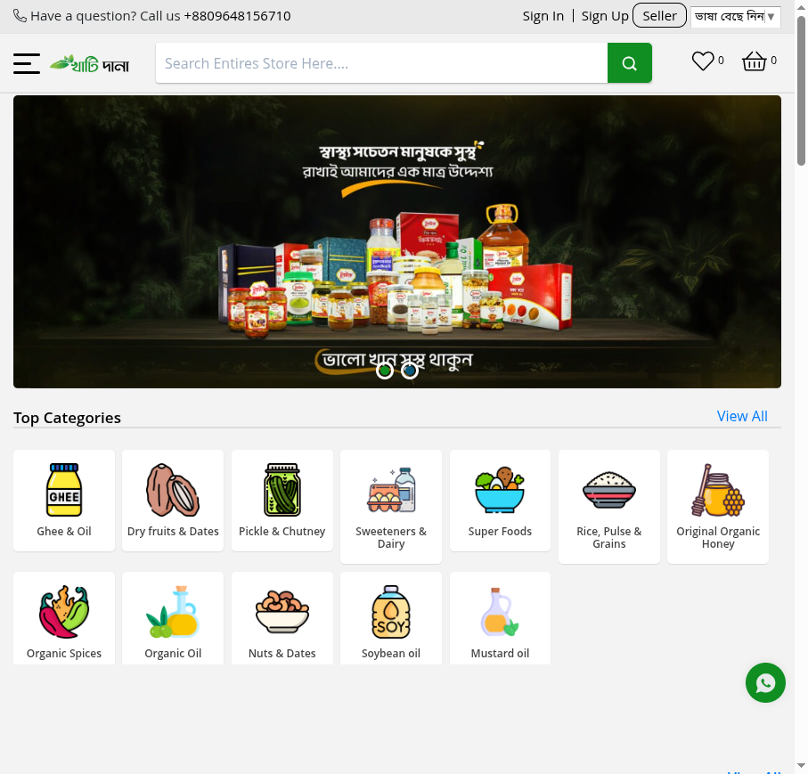
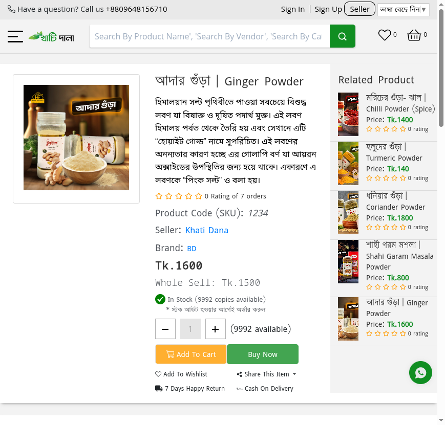

# Khati Dana - Multi-Vendor E-Commerce Platform

<p align="center">
  
  
  
  
</p>

**Khati Dana** is a feature-rich, multi-vendor e-commerce platform built with Laravel 8. It supports organic food/grocery delivery with vendor management, product variations, flash sales, live chat, wallet system, and more.

---

## 🚀 Features

### Core E-Commerce
- **Multi-Vendor Marketplace** - Vendor registration, dashboard, product management
- **Product Management** - Categories, sub-categories, brands, collections, attributes (size, color, RAM, etc.)
- **Product Variations** - Dynamic pricing based on attributes (color, size, custom attributes)
- **Shopping Cart** - Add/update/remove items, coupon codes, guest checkout
- **Order Management** - Order tracking, invoices, returns, cancellations, downloadable products
- **Checkout** - Multiple payment gateways (bKash, Nagad, Rocket, Bank Transfer, Cash on Delivery)

### Marketing & Sales
- **Flash Sales / Campaigns** - Time-limited deals with countdown timers
- **Coupons & Discounts** - Percentage/fixed amount, usage limits, vendor-specific
- **Wishlist** - Save products for later
- **Product Reviews & Ratings** - Customer feedback system
- **Blogs & Classified Ads** - Content marketing features

### User Management
- **Role-Based Access** - Super Admin, Admin, Vendor, Customer
- **Social Authentication** - Google & Facebook OAuth
- **OTP Verification** - SMS/Email based registration & password recovery
- **Wallet/Points System** - Loyalty points, referrals, withdrawals

### Vendor Features
- Vendor dashboard with sales analytics
- Product/Inventory management
- Order fulfillment
- Commission management
- Payout/Withdrawal requests

### Admin Panel
- Complete site settings (shipping, payments, appearance, SEO)
- User/Vendor management
- Order & commission reports
- Category/Brand/Attribute management
- Slider/Banner management
- Pages/CMS management

### Communication
- Live chat between customers and vendors
- Ticket/Support system
- Email & SMS notifications
- Firebase push notifications

---

## 📋 Requirements

| Requirement | Version |
|-------------|---------|
| PHP | ^7.4 \| ^8.0 |
| Composer | ^2.0 |
| Node.js | ^14.x |
| NPM | ^6.x |
| MySQL | ^5.7 \| ^8.0 |
| Extensions | BCMath, Ctype, Fileinfo, JSON, Mbstring, OpenSSL, PDO, Tokenizer, XML, GD/Imagick |

---

## 🛠 Installation

### 1. Clone & Install Dependencies

```bash
git clone <repository-url>
cd ecommerce2

# PHP dependencies
composer install

# Node dependencies
npm install
```

### 2. Environment Configuration

```bash
cp .env.example .env
php artisan key:generate
```

Edit `.env` with your configuration:

```env
APP_NAME='Khati Dana'
APP_URL=http://localhost:8000

DB_CONNECTION=mysql
DB_HOST=127.0.0.1
DB_PORT=3306
DB_DATABASE=ecommerce_2
DB_USERNAME=root
DB_PASSWORD=

# Mail (configure for production)
MAIL_DRIVER=smtp
MAIL_HOST=smtp.gmail.com
MAIL_PORT=465
MAIL_USERNAME=your-email@gmail.com
MAIL_PASSWORD=your-app-password
MAIL_ENCRYPTION=ssl
MAIL_FROM_ADDRESS=your-email@gmail.com
MAIL_FROM_NAME="Khati Dana"

# Social Login (optional)
GOOGLE_CLIENT_ID=your-google-client-id
GOOGLE_CLIENT_SECRET=your-google-client-secret
GOOGLE_CALL_URL="${APP_URL}/auth/google/callback"

FACEBOOK_CLIENT_ID=your-facebook-app-id
FACEBOOK_CLIENT_SECRET=your-facebook-app-secret
FACEBOOK_CALLBACK_URL="${APP_URL}/auth/facebook/callback"

# Payment Gateways (configure as needed)
# UddoktaPay, SSLCommerz, Stripe, etc.
```

### 3. Database Setup

```bash
# Create database
mysql -u root -e "CREATE DATABASE ecommerce_2 CHARACTER SET utf8mb4 COLLATE utf8mb4_unicode_ci;"

# Import schema & data (recommended - includes sample data)
mysql -u root ecommerce_2 < ecommerce_2.sql

# OR run migrations & seeders
php artisan migrate --force
php artisan db:seed --force
```

### 4. Build Assets & Storage

```bash
# Compile frontend assets
npm run dev

# Create storage symlink
php artisan storage:link

# Clear & cache config
php artisan config:cache
php artisan route:cache
php artisan view:cache
```

### 5. Run Development Server

```bash
php artisan serve
# Or use the npm script:
npm run serve
```

Visit: **http://127.0.0.1:8000**

---

## 🔐 Default Login Credentials

After seeding, these accounts are available (password: `12345678`):

| Role | Email | Username |
|------|-------|----------|
| **Super Admin** | admin@tic.com.bd | superadmin |
| **Admin** | admin@gmail.com | admin |
| **Vendor** | vendor@gmail.com | vendor |
| **Customer** | customer@gmail.com | customer |

---

## 📁 Project Structure

```
ecommerce2/
├── app/
│   ├── Http/Controllers/
│   │   ├── Admin/           # Admin panel controllers
│   │   ├── Frontend/        # Customer-facing controllers
│   │   ├── Vendor/          # Vendor dashboard controllers
│   │   └── Auth/            # Authentication controllers
│   ├── Models/              # 38+ Eloquent models
│   ├── Services/            # Business logic services
│   └── Helpers/             # Helper functions
├── database/
│   ├── migrations/          # 55+ migration files
│   └── seeders/             # Database seeders
├── resources/
│   ├── views/
│   │   ├── frontend/        # Customer views
│   │   ├── admin/           # Admin panel views
│   │   └── vendor/          # Vendor dashboard views
│   └── assets/              # Frontend CSS/JS/images
├── routes/
│   ├── web.php              # Web routes
│   ├── admin.php            # Admin routes
│   └── api.php              # API routes
└── public/                  # Public assets & entry point
```

---

## 🗄 Database Overview (73 Tables)

**Key Tables:**
- `users`, `roles` - Authentication & authorization
- `products`, `categories`, `brands` - Catalog
- `attributes`, `attribute_values`, `attribute_product` - Product variations
- `orders`, `order_details` - Orders
- `carts` / `cart_infos` - Shopping cart
- `campaigns`, `campaing_products` - Flash sales
- `shops` / `vendor_accounts` - Vendors
- `wallets`, `withdraws`, `commissions` - Vendor payouts
- `settings` - Site configuration (170+ settings)
- `sliders`, `pages` - CMS content

---

## ⚙️ Configuration

### Site Settings (Admin Panel → Settings)
Access 170+ settings via admin panel:
- **Shop Info** - Name, logo, contact, social links
- **Payment** - Gateway credentials, COD, wallet
- **Shipping** - Charges, free shipping threshold, zones
- **Appearance** - Colors, slider layout, menu style
- **SEO** - Meta tags, Google Analytics, FB Pixel
- **Notifications** - SMS, Email, Firebase config

### Environment-Specific Config
Key configs in `.env`:
```env
APP_MODE=dev              # dev/production
APP_DEBUG=true            # debug mode
SESSION_DRIVER=file       # file/redis/database
QUEUE_CONNECTION=sync     # sync/redis/database
```

---

## 🎨 Frontend Stack

- **CSS Framework**: Bootstrap 4
- **JavaScript**: jQuery, Vue 2, Slick Slider
- **Build Tool**: Laravel Mix (Webpack)
- **Icons**: Font Awesome 5 Pro, IcoFont
- **Fonts**: Google Fonts, icofont

### Compile Commands
```bash
npm run dev       # Development build
npm run watch     # Watch for changes
npm run hot       # Hot module replacement
npm run prod      # Production build (minified)
```

---

## 📱 Pages & Routes

### Customer Frontend
| Route | Description |
|-------|-------------|
| `/` | Homepage with sliders, categories, products |
| `/product` | All products with filters |
| `/product/{slug}` | Product detail page |
| `/category/{slug}` | Category products |
| `/brand/{slug}` | Brand products |
| `/cart` | Shopping cart |
| `/checkout` | Checkout page |
| `/account` | User dashboard |
| `/order` | Order history |
| `/vendors` | Vendor listings |
| `/blogs` | Blog listing |

### Vendor Dashboard
| Route | Description |
|-------|-------------|
| `/setup/vendor` | Vendor registration |
| `/account/dashboard` | Vendor dashboard |
| `/ads` | Classified ads management |

### Admin Panel
| Route | Description |
|-------|-------------|
| `/admin` | Admin dashboard |
| `/admin/settings` | Site settings |
| `/admin/users` | User management |
| `/admin/products` | Product management |
| `/admin/orders` | Order management |

---

## 🔌 Key Packages Used

| Package | Purpose |
|---------|---------|
| `laravel/ui` | Auth scaffolding |
| `laravel/socialite` | OAuth (Google, Facebook) |
| `bumbummen99/shoppingcart` | Shopping cart |
| `intervention/image` | Image manipulation |
| `maatwebsite/excel` | Excel import/export |
| `mckenziearts/laravel-notify` | Toast notifications |
| `fideloper/proxy` | Trusted proxies |
| `fruitcake/laravel-cors` | CORS handling |

---

## 🧪 Testing

```bash
# Run PHPUnit tests
./vendor/bin/phpunit

# Or via artisan
php artisan test
```

---

## 🚀 Deployment

### Production Checklist
- [ ] Set `APP_DEBUG=false`
- [ ] Set `APP_ENV=production`
- [ ] Configure `APP_URL` with HTTPS
- [ ] Set strong `APP_KEY`
- [ ] Configure production database credentials
- [ ] Set up mail driver (SMTP)
- [ ] Configure payment gateway credentials
- [ ] Set up Redis for sessions/queues/cache
- [ ] Run `php artisan config:cache && php artisan route:cache && php artisan view:cache`
- [ ] Run `npm run prod`
- [ ] Set up queue worker: `php artisan queue:work --daemon`
- [ ] Set up scheduler cron: `* * * * * php artisan schedule:run`
- [ ] Configure web server (Nginx/Apache) with proper document root

### Nginx Example
```nginx
server {
    listen 80;
    server_name yourdomain.com;
    root /path/to/ecommerce2/public;

    index index.php;

    location / {
        try_files $uri $uri/ /index.php?$query_string;
    }

    location ~ \.php$ {
        fastcgi_pass unix:/var/run/php/php8.1-fpm.sock;
        fastcgi_param SCRIPT_FILENAME $realpath_root$fastcgi_script_name;
        include fastcgi_params;
    }

    location ~ /\.(?!well-known).* {
        deny all;
    }
}
```

---

## 📸 Screenshots

| Homepage | Product Page |
|----------|--------------|
|  |  |

---

## 🤝 Contributing

1. Fork the repository
2. Create a feature branch: `git checkout -b feature/amazing-feature`
3. Commit changes: `git commit -m 'Add amazing feature'`
4. Push to branch: `git push origin feature/amazing-feature`
5. Open a Pull Request

---

## 📄 License

This project is open-sourced software licensed under the [MIT license](LICENSE.txt).

---

## 🙏 Acknowledgments

- [Laravel Framework](https://laravel.com)
- [Bootstrap](https://getbootstrap.com)
- [Font Awesome](https://fontawesome.com)
- All open-source packages used in this project

---

## 📞 Support

For support, email: **support@tic.com.bd**

**Project Maintainer**: TIC (Trusted E-Commerce Platform)